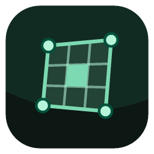
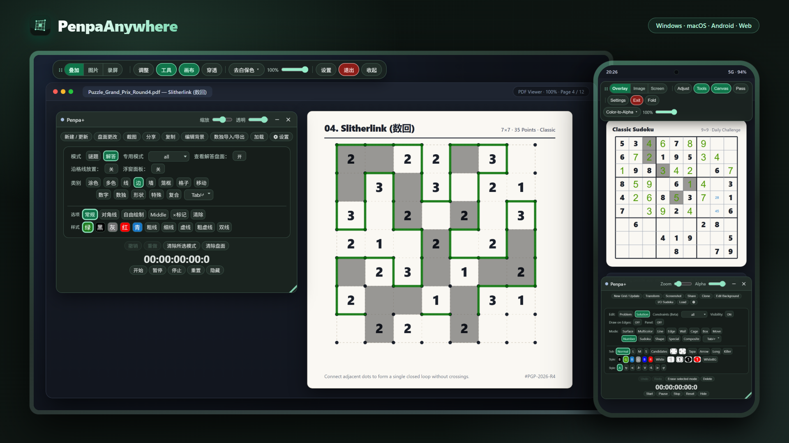
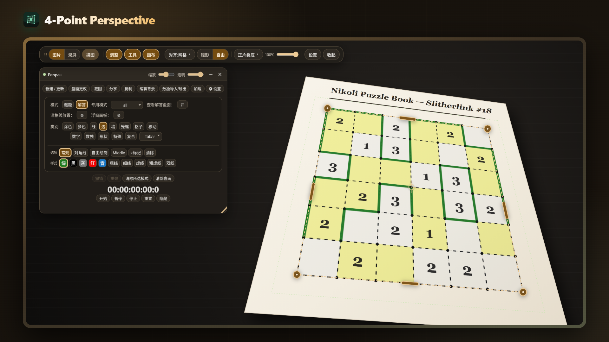
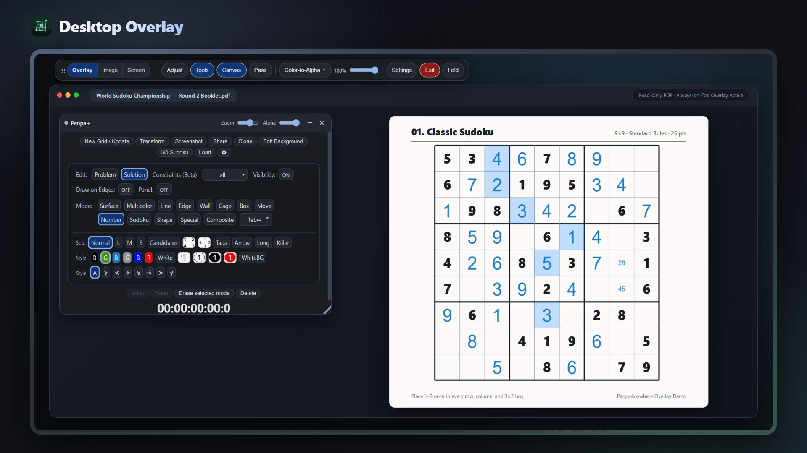

#  PenpaAnywhere

English | [简体中文](README.zh-CN.md)

Use [Penpa+](https://github.com/swaroopg92/penpa-edit) in a floating overlay on Windows, macOS, Android, and Web.



## Features

- Transparent overlay over windows, images, and screen capture
- Perspective alignment for tilted or skewed puzzles
- Blend modes and click-through
- Dynamic theming and custom CSS
- Auto-save progress and settings
- i18n support

## Showcase

| Perspective Alignment | Desktop Overlay |
| :---: | :---: |
|  |  |

## Quick Start

```bash
git submodule update --init --recursive
pnpm install
pnpm run sync:penpa

# Web
pnpm run dev
pnpm run build

# Windows / macOS
pnpm run tauri:dev
pnpm run tauri:build

# Android
pnpm run android:prepare
cd android && ./gradlew assembleDebug
```

## License

[MIT License](LICENSE)
