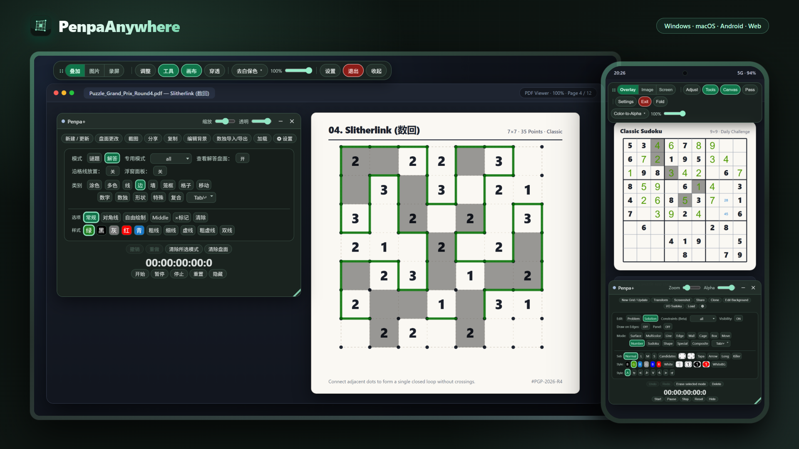
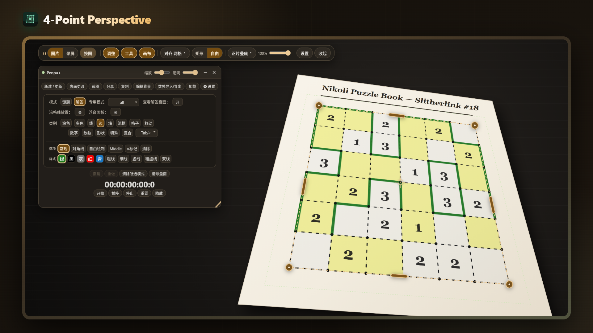
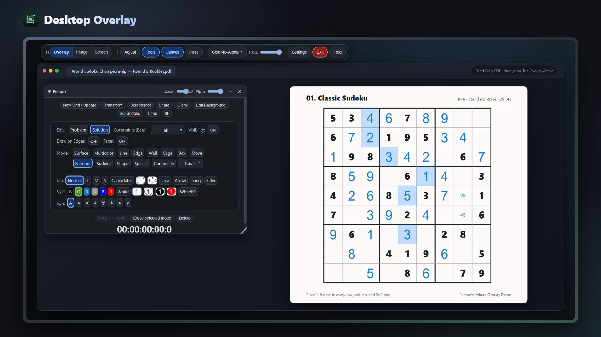

#  PenpaAnywhere

[English](README.md) | 简体中文

在悬浮窗中使用 [Penpa+](https://github.com/swaroopg92/penpa-edit)，支持 Windows、macOS、Android 与 Web。



## 功能

- 透明叠加于系统窗口、图片或屏幕捕获之上
- 透视对齐，适配斜拍或倾斜的题面
- 透明混合模式与点击穿透
- 动态主题配色与自定义 CSS
- 自动保存进度与设置
- i18n 支持

## 预览

| 透视对齐 | 桌面端叠加 |
| :---: | :---: |
|  |  |

## 构建与运行

```bash
git submodule update --init --recursive
pnpm install
pnpm run sync:penpa

# Web
pnpm run dev
pnpm run build

# Windows / macOS
pnpm run tauri:dev
pnpm run tauri:build

# Android
pnpm run android:prepare
cd android && ./gradlew assembleDebug
```

## 许可证

[MIT License](LICENSE)
